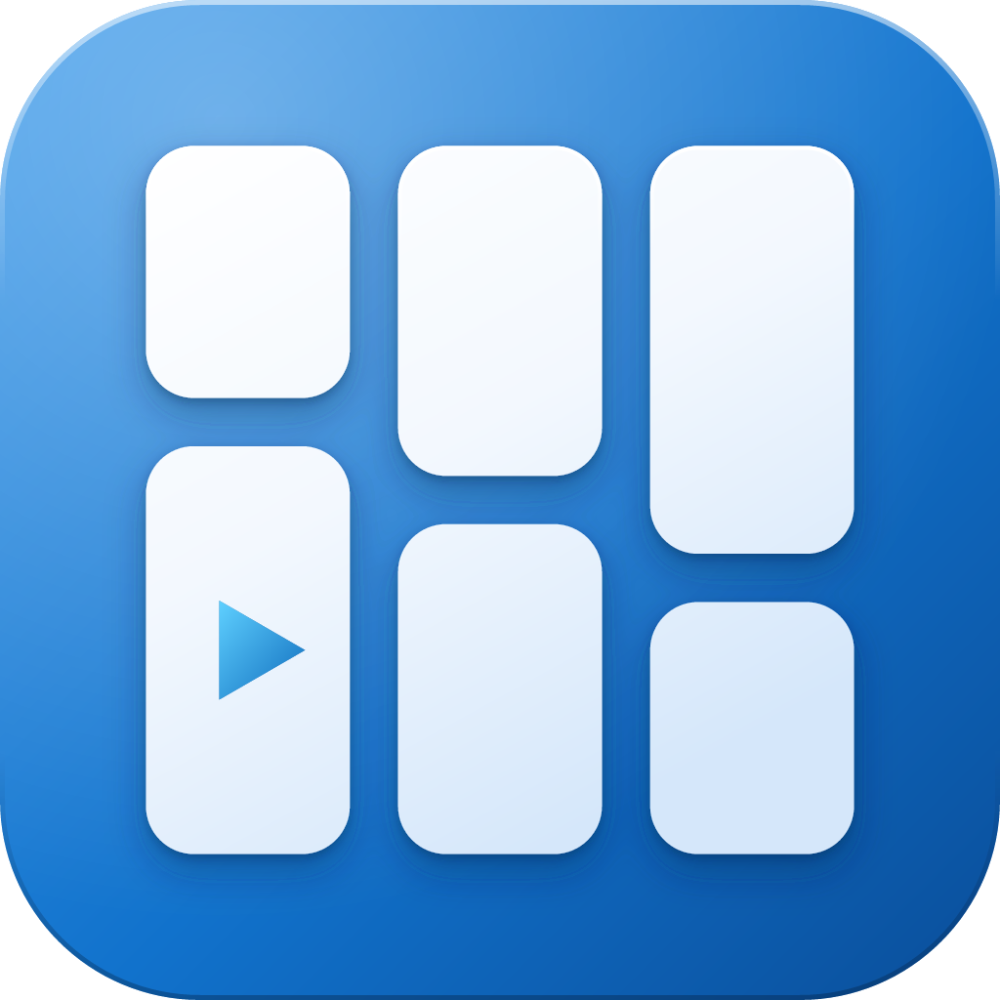
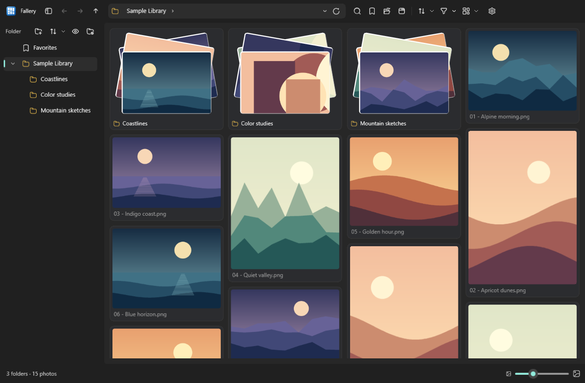

<p align="center">
  
</p>

<h1 align="center">Fallery</h1>

<p align="center">
  <strong>Fallery = Falls + Gallery.</strong> A waterfall-style media browser for Windows, with built-in image viewing and video and audio playback.
</p>

<p align="center">English · <a href="README.zh-CN.md">简体中文</a></p>



## What you can do

- **Browse:** masonry, justified, grid, filmstrip, and list views; folder previews, favorites, and navigation history.
- **View images:** zoom, pan, GIF playback, full screen, and photo metadata. Double-click to zoom in or fit to the window.
- **Play media:** video and audio, playlists, playback speed, resume positions, and A–B repeat.
- **Organize:** search, sort, filter, copy, move, rename, delete, and find duplicate images.
- **Customize:** light and dark themes, adjustable thumbnails, folder exclusions, multiple windows, and live English/Chinese switching.

## Install

**Requirements:** Windows 10 version 2004 / build 19041 or later, or Windows 11. Builds target **x64** and **ARM64**.

Download the `*-Setup.exe` for your architecture from [Releases](https://github.com/LiLittleCat/Fallery/releases). No .NET installation is required.

For a portable build, extract `*-Portable.zip` and run the application.

Installed builds can check for updates in **Settings → App → Version and updates**.

See the [changelog](CHANGELOG.md) for release history.

## Supported media

| Media | Examples |
| --- | --- |
| Images | JPEG, PNG, GIF, BMP, WebP, TIFF, HEIC/HEIF, AVIF |
| Video | MP4, MOV, MKV, AVI, WMV, WebM |
| Audio | MP3, WAV, FLAC, M4A, AAC, WMA, OGG, Opus |

Format support depends on installed Windows codecs; HEVC and AV1 may require extensions. Fallery does not bundle codecs or support subtitles.

## Useful shortcuts

| Action | Shortcut |
| --- | --- |
| Open a folder / new window | `Ctrl+O` / `Ctrl+N` |
| Edit the address / search this computer | `Ctrl+L` or `Alt+D` / `Ctrl+F` |
| Back / forward / parent folder | `Alt+←` / `Alt+→` / `Alt+↑` |
| Parent / back while browsing | `W` / `S` |
| Previous / next media folder | `A` / `D` |
| Refresh folder | `F5` |
| Full screen / leave full screen or viewer | `F11` / `Esc` |
| Fit image / zoom in / zoom out | `Ctrl+0` / `Ctrl+=` / `Ctrl+-` |
| Play or pause / mute | `Space` / `M` |
| Details / playlist | `I` / `L` |
| Delete / permanently delete | `Delete` / `Shift+Delete` — confirmation required |

Hold the right mouse button and drag in the gallery to navigate folders.

## Build from source

Requires Windows and the .NET SDK specified in [global.json](global.json). Built with C# and WinUI 3.

```powershell
dotnet restore
dotnet build -p:Platform=x64
dotnet run -p:Platform=x64
```

For ARM64, replace `x64` with `ARM64`.

To create an installer and update packages:

```powershell
./tools/Build-Release.ps1 -Version 0.1.0 -Architecture x64
```

## Local data

| Build | Data directory |
| --- | --- |
| Installed stable release | `%LOCALAPPDATA%\Fallery` |
| Preview release | `%LOCALAPPDATA%\Fallery.Preview` |
| Local development build | `%LOCALAPPDATA%\Fallery.Dev` |

Settings, playback positions, search indexes, and thumbnails are stored here, including for portable builds. Your media stays in its original folders.

## Credits

- Interface: Windows App SDK / WinUI 3 and the .NET Community Toolkit.
- Icons: Hugeicons Stroke Rounded; see the [bundled font license](Assets/Fonts/LICENSE-Hugeicons.txt).
- Installation and updates: [Velopack](https://github.com/velopack/velopack).

## License

[MIT](LICENSE) © 2026 Yi Liu.
