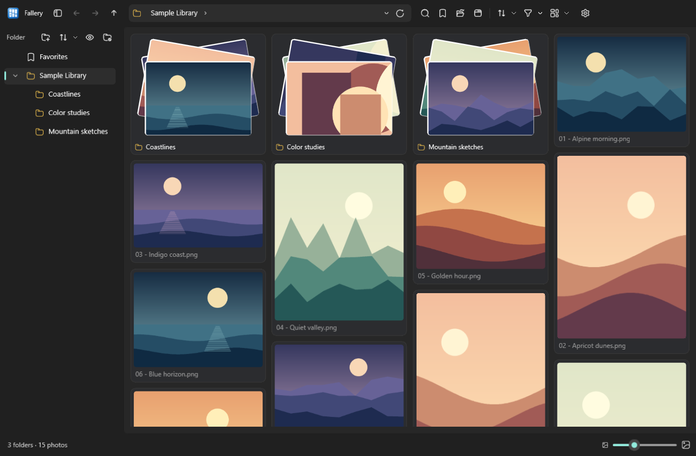
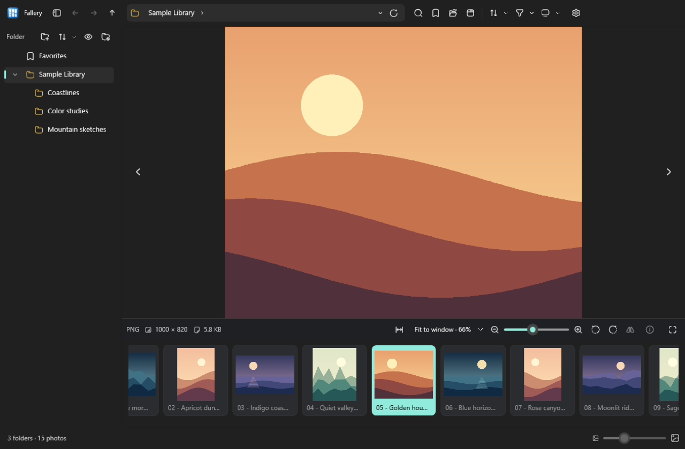
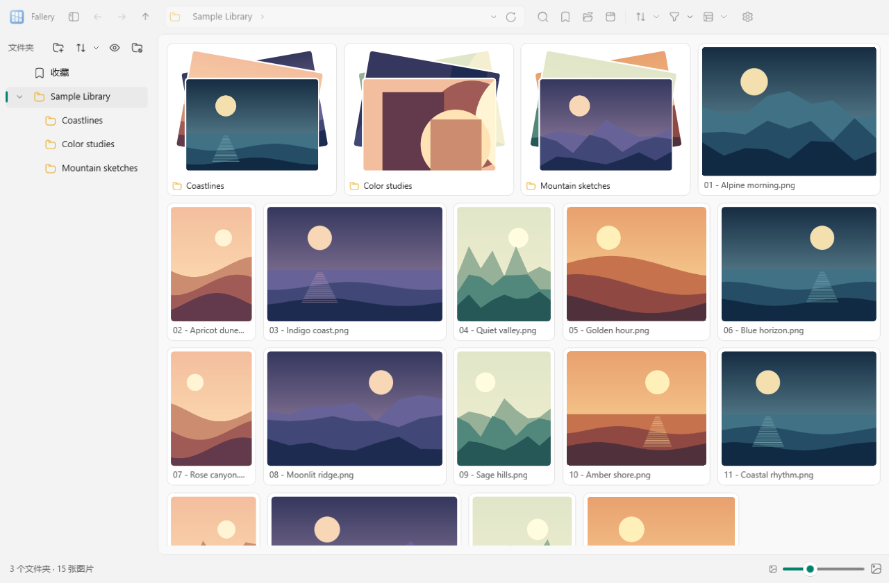

<p align="center">
  
</p>

# Fallery · 瀑廊

**在 Windows 上浏览文件夹、查看图片、播放视频和音频。**

[English](README.md) · 简体中文

Fallery = *Falls* + *Gallery*。用流动的图片布局浏览媒体，同时保留熟悉的文件夹导航和内置查看器。使用 C# / .NET 10 与 WinUI 3 构建。



## 主要功能

- **五种布局：**瀑布视图、自适应等高行、网格视图、大图与底部缩略图、详细列表。
- **文件夹导航：**可展开文件树、文件夹封面、资源管理器式地址栏、收藏、最近位置与前进/后退历史。
- **内置图片查看器：**缩放、拖动、适应窗口、实际大小、GIF 播放、全屏及可用的照片元数据。图片双击放大，再双击恢复适应窗口。
- **视频和音频播放：**倍速、音量、续播、播放列表、A–B 循环和相邻媒体连续播放；视频还支持逐帧、旋转及截图。
- **查找与整理：**排序、类型筛选、本地文件名索引、多选、复制/剪切/粘贴、重命名、新建文件夹及删除确认。相同图片清理按名称、大小和内容匹配，不是视觉相似图片搜索。
- **外观与语言：**亮色、暗色或跟随系统，可调整缩略图大小和侧栏宽度，支持多窗口以及即时切换简体中文和英文。

查看器位于主窗口内。大目录采用虚拟化布局、有容量限制的内存缓存和磁盘缩略图缓存，不会一次性创建全部文件的界面控件。

## 界面展示

### 大图与底部缩略图

逐张查看时保留文件树和地址导航。



### 亮色主题 · 中文界面

在**设置 → 常规 → 语言**中切换，无需重启，所有窗口同步更新。“完成”保留选择，“取消”恢复原语言。



## 安装

**系统要求：**Windows 10 2004 / 内部版本 19041 及以上，或 Windows 11；提供 **x64** 与 **ARM64** 构建。

1. 打开 [Releases](https://github.com/LiLittleCat/Fallery/releases)。
2. 下载适合机器架构的 `*-Setup.exe` 并运行。如果尚无发行版，可以按下方说明从源码构建。
3. 打开文件夹开始浏览。安装包自带运行时，运行时无需安装 .NET SDK。

安装面向当前用户。如果提供 `*-Portable.zip`，也可以解压运行，但设置和缓存仍保存在 LocalAppData，并非所有数据都跟随程序目录。

**更新：**正式安装版在**设置 → 版本与更新**中支持检查、下载、取消和明确确认后重启更新。开发版与解压运行版不进行应用内更新。匿名更新需要能够访问已发布的发行版；私有仓库不能作为匿名更新源。

目前打包流程尚未配置代码签名证书。安装包说明、签名及 GitHub Actions 发版流程见 [部署文档](DEPLOYMENT.md)。

## 媒体格式

| 类型 | 示例 |
| --- | --- |
| 图片 | JPEG、PNG、GIF、BMP、WebP、TIFF、HEIC/HEIF、AVIF |
| 视频 | MP4、MOV、MKV、AVI、WMV、WebM |
| 音频 | MP3、WAV、FLAC、M4A、AAC、WMA、OGG、Opus |

能识别扩展名不代表系统一定能解码内容。Fallery 使用 Windows 图像与媒体 API，**不内置解码器包**。HEVC、AV1 和部分图像或容器格式可能需要安装 Windows 扩展，也可能无法打开。尚未实现字幕支持。

## 常用快捷键

| 操作 | 快捷键 |
| --- | --- |
| 打开文件夹 / 新建窗口 | `Ctrl+O` / `Ctrl+N` |
| 编辑地址 / 全电脑搜索 | `Ctrl+L` 或 `Alt+D` / `Ctrl+F` |
| 后退 / 前进 / 上级 | `Alt+←` / `Alt+→` / `Alt+↑` |
| 浏览时进入上级 / 后退 | `W` / `S` |
| 上一个 / 下一个媒体目录 | `A` / `D` |
| 刷新目录 | `F5` |
| 全屏 / 退出全屏或查看器 | `F11` / `Esc` |
| 适应图片 / 放大 / 缩小 | `Ctrl+0` / `Ctrl+=` / `Ctrl+-` |
| 播放暂停 / 静音 | `Space` / `M` |
| 详细信息 / 播放列表 | `I` / `L` |
| 删除 / 永久删除 | `Delete` / `Shift+Delete`，均需确认 |

快捷键随焦点和当前视图生效。浏览区也支持按住鼠标右键拖动，执行目录导航手势。

## 从源码构建

需要 Windows，以及 [global.json](global.json) 指定的 .NET SDK，目前为 **10.0.403**，允许兼容的补丁版本升级。

```powershell
dotnet restore
dotnet build -p:Platform=x64
dotnet run -p:Platform=x64

# 核心检查与语言资源检查
dotnet run --project Tests/CoreChecks/CoreChecks.csproj -- .
dotnet run --project Tests/LanguageChecks/LanguageChecks.csproj -- .
```

ARM64 构建使用 `-p:Platform=ARM64`。普通构建即使使用 Release 配置，也属于 **Fallery Dev**。

生成安装包和更新文件：

```powershell
./tools/Build-Release.ps1 -Version 0.1.0 -Architecture x64
```

GitHub Actions 的 **Build release** 工作流会构建两个架构并创建待审核的发行草稿。完整流程见 [DEPLOYMENT.md](DEPLOYMENT.md)，验证命令见 [Tests/README.md](Tests/README.md)。

## 本地数据

| 构建类型 | 数据目录 |
| --- | --- |
| stable 正式安装版 | `%LOCALAPPDATA%\Fallery` |
| preview 预览版 | `%LOCALAPPDATA%\Fallery.Preview` |
| 本地开发版 | `%LOCALAPPDATA%\Fallery.Dev` |

这些目录保存设置、续播位置、本地搜索索引和缩略图缓存。原始媒体仍在浏览的文件夹中；显式文件管理操作会处理你选中的文件。正式版、预览版和开发版的数据目录彼此独立。完整目录清单与备份行为见 [DEPLOYMENT.md](DEPLOYMENT.md)。

## 致谢

- 界面使用 Windows App SDK / WinUI 3 与 .NET Community Toolkit。
- 图标使用 Hugeicons Stroke Rounded，见[字体许可](Assets/Fonts/LICENSE-Hugeicons.txt)。
- 安装和更新使用 [Velopack](https://github.com/velopack/velopack)。

Fallery 采用 MIT 许可证；第三方组件保留各自的许可。
