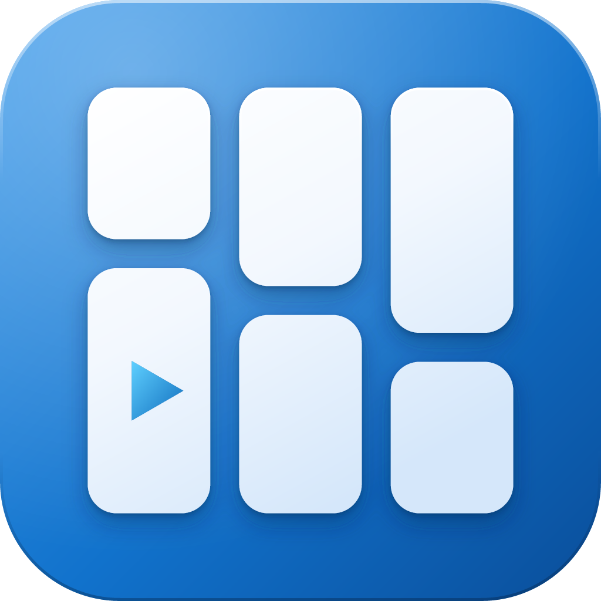

# Fallery 图标



## 设计

- **概念**：三列高矮错落的白色卡片就是瀑布流；左下最大的卡片里有一个播放三角，表示也能播放视频。
- **瀑布**：三条横缝的高度逐列下降，连成一条从左上落到右下的斜线。整体是 180° 旋转对称，有意打破左右镜像（左右镜像时中间会读成字母 H）。
- **比例**：边距 = 画布 / φ⁴；缝宽 g = 卡片宽 W / φ³；圆角 = g；每列长卡 : 短卡 = φ : 1；播放三角高 = W / φ^1.5。详见 [构造图](final/fallery-icon-construction.png)。
- **光影**：光从左上方来。底板蓝色渐变加左上高光，上沿亮边、下沿压暗；卡片白到淡蓝微渐变，带两层投影；播放三角用青蓝渐变。

最初比较过的三个方向见 [compare.png](final/compare.png)（瀑布流卡片 / 字母 F / 逐级下落的播放键）。

## 所有尺寸统一三列

按用户 2026-10-31 的要求，程序图标统一使用光影三列版。标题栏、任务栏和 exe 图标不再根据尺寸切换成两列。

`build_ico.py` 从同一个 `out/fallery-icon-fluent.svg` 渲染 16/20/24/32/40/48/64/256px，保留各尺寸独立渲染的抗锯齿。旧的 `fallery-small*` 文件仅作为历史设计稿保留，不用于程序图标，也不再由打包脚本复制到定稿目录。

## 用在哪

| 场景 | 文件 |
|---|---|
| 系统图标（exe、开始菜单、任务栏） | `../Assets/Fallery.ico`：全部尺寸均为光影三列 |
| WinUI 标题栏 | `../Assets/FalleryTitleBar.scale-*.png`：16 DIP，按 100%/125%/150%/200%/250%/300%/400% 缩放分别使用 16/20/24/32/40/48/64px；由同一三列 SVG 渲染，避免 ICO 第一帧被放大 |
| 安装包、Store 页面、关于页面 | `final/fallery-icon-fluent.svg` / `final/fallery-icon-fluent-1024.png` |
| README、网站、单色印刷、水印 | `final/fallery-mark.svg`（无底板） |
| 需要扁平风格的地方 | `final/fallery-icon.svg`（三列） |

## 修改和重新生成

```
cd logo
uv run ~/.claude/skills/geometric-logo/scripts/logokit.py fallery_logo.py -o out/   # 几何（需要 geometric-logo skill）
uv run --with resvg-py --with pillow python fluent.py                             # 光影
uv run --with resvg-py --with pillow python build_ico.py                          # 生成 .ico 并更新 final/
```

- 改形状：改 `fallery_logo.py` 里的比例变量（`M`、`G_A`、`L_A`、`TRI_H` 等），不要直接改坐标
- 改颜色或光影：改 `fluent.py` 开头的渐变和 `lift` 投影
- 改 .ico 包含的尺寸：改 `build_ico.py` 里的 `SIZES`；所有尺寸使用相同的三列源图
- `out/` 是中间产物，可以删掉重新生成；`final/` 和 `../Assets/Fallery.ico` 是交付物
